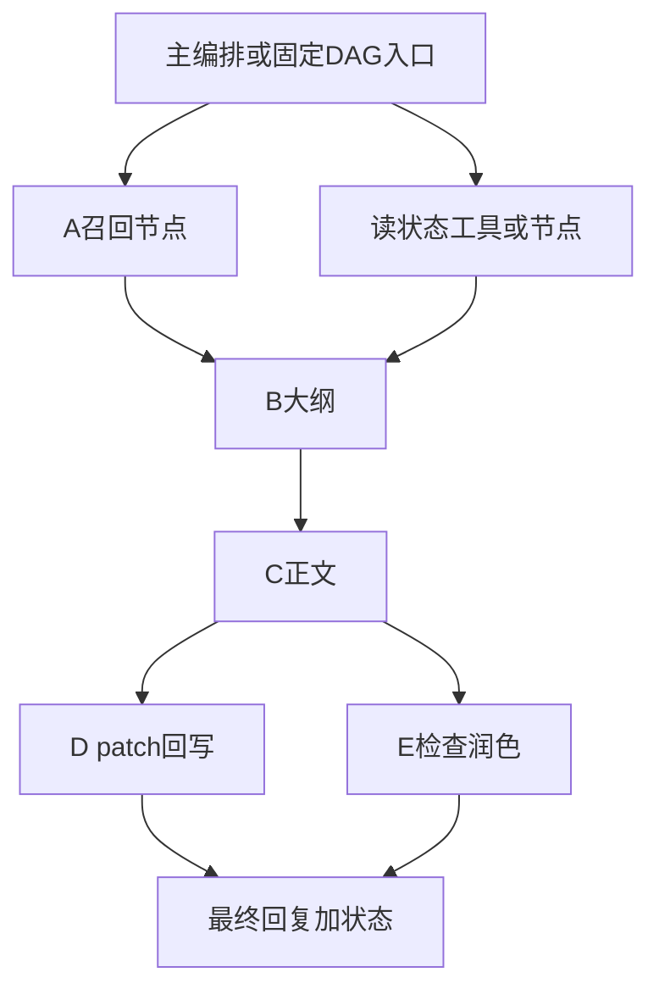
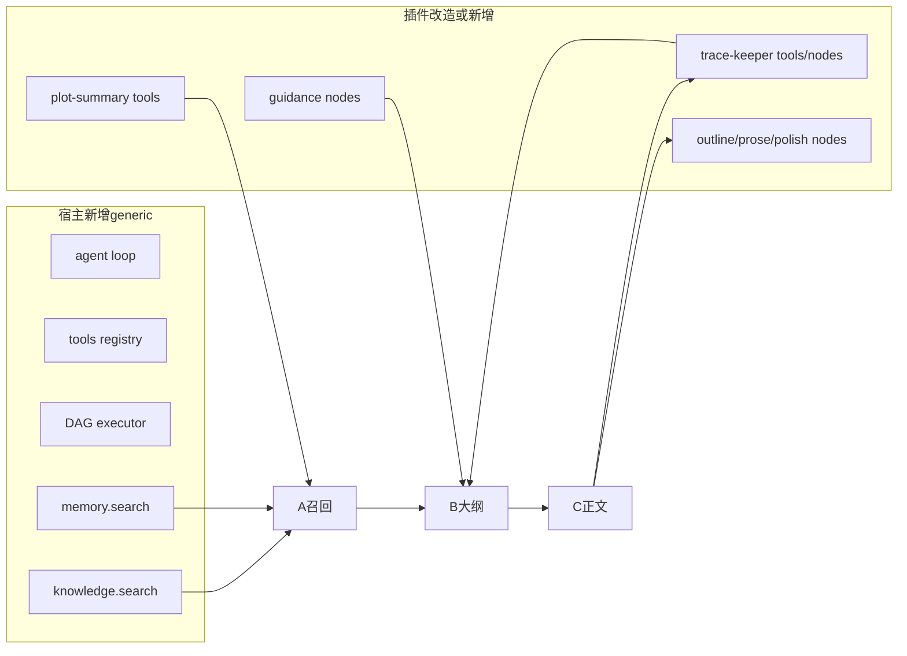

# 53 · Agent Runtime / Tools / 节点图 — 实施计划

> **状态**：**阶段 2 可验证（tools + UI）· 等人工验证** · 节点图未做 · **§16.6 已定案 · proseCommitted SSE 已落地**  


> **分支**：`agent`  
> **优先级**：建议 **P2**（基础设施大；合入前须过 DOC/41 能力问）  
> **关联**：[41](41-plugin-host-generic-principles.md) · [18](18-plugin-host-developer-api.md) · [25](25-security-deployment.md) §6 · [38](38-plugin-sandbox-and-host-evolution.md) · [39](39-plugin-context-and-prompt-assembly.md) · [24](24-regex-and-session-audit.md) · [04-TODO](04-TODO.md)

### 验证切片 C（2026-11-24 · tools + UI · 请停顿验收）

| 已交付 | 说明 |
|--------|------|
| 核心 tools | `lore_search` / `memory_search` / `knowledge_search`（薄封装；OpenAI `function.name` 禁止点号；notes 不对模型暴露） |
| 插件 `runTool` | manifest `tools[]` + 模块 `runTool`；与 `runPluginAction` 分立；沙箱 hook 已挂 |
| 聚合 / dispatch | `collectAgentToolDefinitions` + `dispatchAgentToolCall`；Agent chat 自动出站 |
| 示例插件 | `notes`：仅人机 serverActions（不对 Agent 暴露 tools） |
| UI | 本对话设置 → 绑定：**Agent 模式**开关 |
| 单测 | `agent-*.test.ts` + `chat-agent-run` → **16** 全绿 |

```bash
cd server && node --import tsx --test test/agent-loop.test.ts test/agent-sse-tool-calls.test.ts test/chat-agent-run.test.ts test/agent-tools-aggregate.test.ts
```

**手工验证建议**

1. 本对话设置打开 **Agent 模式** → 发消息（模型若调用 `memory.search` / `knowledge.search` / `notes.list` 可见多步）  
2. 关开关 → 确认自动召回恢复  
3. 响应头 `X-Agent-Mode: on`；可选看 SSE `arousal.agent`  

**未做（下一刀）**：节点图 DAG、字段级 trace.patch、大纲/润色节点。

---

## 0. 一句话目标

在宿主中落地 **完全 generic** 的 Agent 能力面：

1. **多步循环壳**（可取消、有上限、多段 upstream 同属一次 run）  
2. **真工具调用**（OpenAI 兼容 `tools` / `tool_calls`；插件注册 handler）  
3. **节点图 DAG**（插件注册节点类型；用户配置图；执行器调度子 agent）

业务角色（召回 / 大纲 / 正文 / 追踪器 patch / 润色等）**全部在插件**；宿主零字节产品特化。

---

## 1. 产品愿景（讨论定案）

### 1.0 双模式并存（用户选择 · 已定案）

| 模式 | 谁选 | 召回 / 设定 / RAG | 主路径 |
|------|------|-------------------|--------|
| **原始（简单）模式** | 用户（建议会话级开关；可另设全局默认） | **维持现状**：assemble 内自动 memory / lore / knowledge | 单次 completion，与今天一致 |
| **Agent 模式** | 同上 | **关闭**主路径自动注入；由节点经 **工具调用** 自决检索与读写 | 绑定图 → DAG / agent loop |

- 同一会话同一时刻只走一种召回策略；**禁止** Agent 下再叠全量自动 memory/lore/RAG（防双份上下文与双份计费）。  
- 插件旁路（如 Historian 定时摘要）与模式正交，不替代上述主路径分叉。  
- 未开 Agent = 原始模式（opt-in）。

### 1.1 主 agent + 专才子 agent

默认 **声明式流水线**，由节点图表达；主 agent「每轮自由派活」为可选高级模式（后置）。

| 示例子角色 | 职责 | 关键依赖 |
|------------|------|----------|
| A 召回 | 据上下文自决记忆 / 设定关键词或向量查询 | 检索类 tools |
| B 大纲 | 读当前状态（如追踪器）+ 写作指导 → 大纲 | A 输出 + 状态读 tools |
| C 正文 | 按大纲填充回复正文 | B 输出 |
| D 回写 | **工具只改变动字段**（非整表 JSON），防漂移 | 细粒度 patch tools |
| E 收尾 | 逻辑检查、润色 | C（及可选 D） |
| … | 可扩展 | 同一 job / tool / 节点面 |



### 1.2 节点图配置面

| 层 | 职责 |
|----|------|
| **宿主** | 图 schema、无环/端口校验、DAG 执行器、编辑壳、cancel/进度、与 generation 绑定 |
| **插件 manifest** | 声明 `nodeTypes`（端口、参数 schema、permissions/tools） |
| **插件实现** | `node.run(ctx, inputs, params)`；内部可 complete / 调 tools |
| **用户** | 对话级或全局预设图；改边、改参数、切换预设 |

**落地次序**：先 JSON 图 + 简单列表 UI → 再可视化画布。

### 1.3 硬约束（DOC/41）

- 宿主 **不得** 出现 bundled 插件 id、追踪器/大纲/MEMO 等产品算法或字段形状。  
- 禁止 `if (pluginId === '…')` / `if (nodeType === 'trace-…')`。  
- 单测只用 `fixture-plugin-*`。  
- `customParams` **继续禁止**覆盖 `tools` / `tool_choice`（[25](25-security-deployment.md) §6）；tools 仅由宿主注册表写入。

---

## 2. 现状基线（缺口）

| 区域 | 今天 | 缺口 |
|------|------|------|
| 主聊天 | 单次 assemble → 单次 `chat/completions` stream → 落盘 | 无 agent 循环 |
| 消息 | `system\|user\|assistant` + string content | 无 `tool_calls` / `role:tool` |
| Turn | `receives[].content` + optional `reasoning` | 无 steps / agentTrace |
| tools | 仅出现在 customParams **黑名单** | 宿主从不写出站 `tools` |
| SSE | 透传 content/reasoning + `arousal.*` | 不解析 `tool_calls`；无 `arousal.step` |
| Generation | 单次流；同会话顶替 | 无「一次 run 多段 upstream」 |
| 插件 LLM | `complete` / `completeWithContext`（非流式） | 非主聊天 tool 环 |
| 多步 | 插件自管 Promise / Web lifecycle | 无通用 DAG；服务端 persist hook 仍规划项 |
| UI | User + Assistant 气泡 | 无通用步骤 / 插件区块（`appendPluginBlock` 规划中） |

关键路径：`server/src/routes/chat-routes.ts`、`chat-assemble.ts`、`custom-params-merge.ts`、`sse-assistant.ts`、`chat-generation-registry.ts`、`plugin-complete.ts`、`web/src/utils/chat-api.ts`、`web/src/composables/chat-session/completion.ts`。

---

## 3. 总序与阶段门禁

```text
阶段 1  多步循环壳 + tool_calls 解析/回灌骨架（fixture 工具）
   ↓ 门禁：单测 + fixture 跑通 cancel/maxSteps
阶段 2  真工具注册表 + 权限 dispatch + 审计（插件贡献 tools）
   ↓ 门禁：至少 1 个真工具（如 patch）+ 宿主 grep/能力问
阶段 3  节点图 DAG（JSON 执行器 → 列表 UI → 可选画布）
   ↓ 门禁：fixture 节点图；业务节点在插件迁移
（可选）时间线一等 steps / appendPluginBlock / 服务端 persist hook
```

**不要**：先空转无 tools 的主聊天多步；先堆多 agent 再补单 agent 循环；用 customParams 偷传 `tools`。

---

## 4. 阶段 1 — Agent Loop（循环壳）

### 4.1 目标

宿主提供 **一次 Agent Run**：

```text
loop:
  upstream chat/completions（可带 tools）
  if finish / 无 tool_calls → 产出最终 assistant 文本 → break
  else 执行 tool_calls → 追加 tool 消息 → continue
until maxSteps or cancel
```

阶段 1 可用 **0～1 个 fixture 工具**（如 `fixture.echo`）验证环，不必上真业务工具。

### 4.2 契约草案

#### 4.2.1 Run 与 Generation

| 概念 | 定案方向 |
|------|----------|
| `agentRunId` | 一次用户可见发送/再生对应一次 run；可含多段 upstream |
| `generationId` | 沿用现有客户端预生成 id；cancel 取消 **整次 run**（含进行中的 tool 与下一段 completion） |
| 同会话并发 | 保持「新 run 顶替旧 run」；写盘仍靠 generation 语义，不引入对话全局文件锁（除非另立任务） |
| `maxSteps` | 默认硬顶（建议 8～16，可配置上限 clamp）；超限 → 明确错误码，不静默截断为成功 |
| 空闲超时 | 每段 upstream 沿用现有 idle abort；tool 执行设独立 timeout |

#### 4.2.2 消息形状（出站 / 环内）

扩展内部 `ChatMessage`（或并行 `AgentMessage`）支持：

| role | 字段 |
|------|------|
| `assistant` | `content?: string`；`tool_calls?: { id, type:'function', function:{ name, arguments } }[]` |
| `tool` | `tool_call_id`；`content: string`（结果序列化） |
| 既有 | `system` / `user` / `assistant` 纯文本 |

`validateChatMessages` / `PluginCompleteMessage`：阶段 1 先在 **agent loop 专用路径** 放宽；主路径无 tools 时行为不变。是否让 `plugin.complete` 同步支持 tools → 阶段 2 对齐（建议同步，避免双协议）。

#### 4.2.3 流式解析

| 项 | 定案方向 |
|----|----------|
| `delta.tool_calls` | 按 index 累加 id/name/arguments 片段（与 OpenAI SSE 一致） |
| `finish_reason` | 识别 `tool_calls` vs `stop` |
| 对客户端 | **阶段 1 MVP**：主气泡仍可只推最终文本；中间态写入 audit / 可选 SSE `arousal.agent`（见 §4.2.5） |
| reasoning | 与现有一致；tool 轮次是否保留 reasoning → 默认保留在 run trace，不进 TurnReceive 除非 L2 |

#### 4.2.4 落盘（阶段 1 最小）

- **默认**：仅最终 assistant `content` 写入现有 `TurnReceive`（兼容今天 UI/历史组装）。  
- **Run trace**：写入 audit（扩展 `calls` / 新 `agentRuns`）或会话旁路文件；**不**改 `flattenTurnsToChatMessages` 除非明确「历史回放 tools」（后置）。  
- 取消：整 run 不落盘（对齐现有 `userCancelled` 跳过 persist）。

#### 4.2.5 SSE（建议）

| 事件 | 阶段 | 含义 |
|------|------|------|
| 现有 OpenAI delta | 1 | content / reasoning；另累加 tool_calls（服务端内部） |
| `arousal.agent` | 1 可选 / 2 建议 | `{ phase:'tool_call'|'tool_result'|'step', ... }` opaque |
| `arousal.persist` | 1 | 仍在 run 成功结束时一次 |

前端 `readSseStream`：未知 `arousal.*` 必须安全忽略（向前兼容）。

### 4.3 主要改动面（阶段 1）

| 路径 | 工作 |
|------|------|
| 新模块建议 `server/src/agent-loop.ts`（名可再议） | 循环编排、maxSteps、tool dispatch 钩子 |
| `chat-routes.ts` / upstream 管道 | 可选走 agent loop（feature 开关或会话配置） |
| `sse-assistant.ts` | 累加 tool_calls |
| `chat-generation-registry.ts` | run 级 abort 传给 loop |
| `custom-params-merge.ts` | **保持** tools 黑名单；loop 显式写 tools |
| `server/test/**` | fixture：echo tool 两轮后停；cancel；maxSteps |
| `web` | MVP 可不变；若发 `arousal.agent` 则忽略即可 |

### 4.4 验收（阶段 1）

- [ ] fixture 工具：模型（或 mock upstream）返回 tool_calls → 执行 → 第二轮最终文本 → 落盘 content  
- [ ] cancel 中途：无 persist；registry 清理  
- [ ] maxSteps 超限：错误码稳定；无半写入成功态  
- [ ] 关闭 agent 时：旧单次 completion 路径行为回归  
- [ ] `npm run check:host-no-plugin-ids` + DOC/41 能力问  

---

## 5. 阶段 2 — 真工具注册表

### 5.1 目标

任意插件经 manifest 声明 tools；宿主聚合 schema、出站注入、按名 dispatch；handler 在插件；权限与审计齐全。

### 5.2 Manifest 草案

```json
{
  "tools": [
    {
      "name": "memory.search",
      "description": "…",
      "parameters": { "type": "object", "properties": { "query": { "type": "string" } }, "required": ["query"] },
      "permissions": ["memory.read"]
    }
  ]
}
```

| 规则 | 说明 |
|------|------|
| 工具名 | 建议 `pluginId.action` 或全局唯一字符串；冲突 → 加载失败 |
| 聚合 | 仅 **启用** 且权限满足的插件 / 核心 tools 进入某次 run 的 `tools` 数组 |
| `tool_choice` | 默认 `auto`；节点/图参数可覆盖为 `none` / 强制某工具（仍 generic） |
| Handler | **已定案**：新建 **`runTool(name, args, api)`**（与 `runPluginAction` **分立**，禁止混用/双写同一入口） |

#### 5.2.1 `runTool` 与「tools 适配层」（已定案）

```text
LLM tool_calls
  → 宿主 dispatch（鉴权、审计、timeout）
  → runTool(name, args, api)
  → 薄适配：调用现有 Host API / 已有能力（memory 检索、lorebook、conversation、插件自身 state…）
  → 返回 string/JSON 给下一轮 messages
```

| 定案 | 说明 |
|------|------|
| **新建 `runTool`** | LLM 可调用工具的专用导出；契约：schema 在 manifest `tools[]`，实现 `runTool` |
| **不复用 `runPluginAction`** | action = 人机/按钮/命令式；tool = 模型可调用。两套 permissions 声明可并存于同一插件，但入口分离 |
| **新建 tools 适配（薄封装）** | 不重写检索/落盘引擎；tools 只做参数校验 + 调现有能力 + 结果截断/序列化 |
| **能力归属** | **通用 syscall**（如 `memory.search`、`knowledge.search`）：宿主提供 Host API，并由 **核心/内置 tools 注册**（名称与实现仍 generic，无产品字段）；**领域工具**（如追踪器 patch）：插件 manifest 声明 + 插件 `runTool` 内调自身逻辑 / Host API |
| **禁止** | 在 `runPluginAction` 里偷偷当 tool；tools 内复制一套 Lance/组装逻辑；宿主 tools 出现追踪器/大纲等产品形状 |

### 5.3 首批真工具方向（插件实现，非宿主）

| 工具类 | 用途 | 对应愿景 |
|--------|------|----------|
| 记忆 / lore / 知识库 search | 关键词或向量检索 | A |
| 状态 read | 读追踪器等 opaque 快照 | B |
| 状态 patch | **JSON Patch / 字段级 merge**，禁止整表盲写 | D（防漂移核心） |
| （可选）lorebook 写入 | 摘要类副作用 | 现有 plot-summary 迁移预备 |

宿主只提供 **dispatch + 权限断言**；检索/patch 算法在插件或既有 Host API 之上封装。

### 5.4 审计

扩展 [24](24-regex-and-session-audit.md) 形状：

- 每次 tool：`name`、args 摘要、结果摘要、latency、ok/error  
- 每段 completion：usage、finish_reason  
- **不**把完整密钥或超大 state 原文写入 audit（截断策略与现网 debug 一致）

### 5.5 降级

部分本地模型无 tools：

- 会话/预设开关：`toolCalling: off | native | promptFallback`  
- `promptFallback`（L0）：把工具说明注入 system，解析约定 JSON/XML —— **实现可后置**；阶段 2 至少文档化，native 为默认真路径  

### 5.6 验收（阶段 2）

- [ ] 两插件同时注册 tools，聚合无冲突；禁用插件工具消失  
- [ ] 无权限 → 不进入出站 tools，且直接 call 被拒  
- [ ] patch 工具：只改声明字段；单测防整表覆盖  
- [ ] audit 可见 tool 步骤  
- [ ] 宿主无业务字段形状；fixture + 真插件分离  

---

## 6. 阶段 3 — 节点图（多 Agent 配置面）

### 6.1 目标

用户用 **DAG** 配置「谁接谁、谁并行」；插件注册节点类型；执行器驱动子 complete / 子 agent loop。

### 6.2 图文档草案

```json
{
  "schemaVersion": 1,
  "id": "rp-standard",
  "nodes": [
    { "id": "n1", "type": "fixture.recall", "params": {} },
    { "id": "n2", "type": "fixture.outline", "params": {} },
    { "id": "n3", "type": "fixture.prose", "params": {} }
  ],
  "edges": [
    { "from": "n1", "fromPort": "out", "to": "n2", "toPort": "recall" },
    { "from": "n2", "fromPort": "out", "to": "n3", "toPort": "outline" }
  ]
}
```

| 规则 | 定案方向 |
|------|----------|
| 无环 | 校验失败不可保存 / 不可执行 |
| 端口类型 | 起步：`text` \| `json` \| `opaque`；不兼容则校验失败 |
| 并行 | 入边满足的节点同时跑；汇合节点等全部前驱 |
| 失败策略 | 默认 fail-fast 取消下游；节点 params 可标 `optional`（后置） |
| 存储 | 全局预设目录 + 会话覆盖（对齐其它会话稀疏配置） |
| 版本 | `type` + 插件声明的 `nodeTypes[].version`；不匹配 → 图无效提示，禁止静默跑 |

### 6.3 节点类型注册（manifest）

```json
{
  "nodeTypes": [
    {
      "type": "my-plugin.outline",
      "version": 1,
      "inputs": [{ "name": "recall", "valueType": "text" }],
      "outputs": [{ "name": "out", "valueType": "text" }],
      "paramsSchema": { "type": "object", "properties": { "modelOverride": { "type": "string" } } },
      "permissions": ["plugin.complete"]
    }
  ]
}
```

插件实现：`runNode(type, { inputs, params, signal, api }) → { outputs }`。

节点内部允许：

- 单次 / 多次 `complete`  
- 开启 **子 agent loop**（复用阶段 1–2，独立 maxSteps 配额，计入父 run）  
- 只调 tools 不 LLM（纯函数节点）

### 6.4 执行器

建议模块：`server/src/agent-graph/`（`validate.ts`、`execute.ts`、`types.ts`）。

```text
validate(graph, catalog) → ok | errors[]
execute(graph, ctx):
  拓扑就绪集 → Promise.all 可并行节点
  每节点：plugin.runNode（沙箱走 Host API）
  边：拷贝 outputs → 下游 inputs
  进度：arousal.agent / 通知中心 progress
  cancel：AbortSignal 下发所有 in-flight
```

**主聊天接入方式（实施时二选一，禁止长期双路径）**：

| 方案 | 说明 | 倾向 |
|------|------|------|
| A. 会话绑定图，send 时跑图，图的「正文输出端口」写入 TurnReceive | 替换单次 completion | 愿景对齐 |
| B. 图作为插件旁路（Web lifecycle），主聊天仍单次 completion | 改动小 | 仅过渡，不推荐长期 |

定案倾向：**方案 A**（阶段 3 后半）；阶段 3 前半可先用 HTTP `POST …/agent-graphs/:id/run` + fixture 验证执行器。

### 6.5 UI

| 子阶段 | 内容 |
|--------|------|
| 3a | JSON 导入/导出 + 只读拓扑列表 + 校验错误展示 |
| 3b | 简单编辑：加节点、选 type、连边、改 params（非画布） |
| 3c | 可视化画布（后置；可独立排期） |

编辑壳在宿主；节点「自定义控件」若需要，仅用 **generic schema form**（与插件 settingsSchema 同模式），禁止宿主特化某节点 UI。

### 6.6 与现有插件迁移

| 现有能力 | 迁法 |
|----------|------|
| plot-summary 自动摘要 | 可选节点或图旁路；勿把摘要算法塞进执行器 |
| guidance-generate | 指导可作为图前驱节点或注入端口 |
| trace-keeper | **read / patch 工具 + 节点**；Together/Separate 留插件 |
| 记忆 / lore / RAG | 暴露为 search tools，供召回节点调用 |

迁移 **不**要求一次切完；旧 lifecycle 路径可并存至图预设稳定（但禁止永久双写同一状态 —— 遵从「禁止兼容性代码」：并存须用户明示截止日期，或直接切换）。

### 6.7 验收（阶段 3）

- [ ] fixture 三节点 DAG 并行边 + 汇合；结果稳定  
- [ ] 坏图（环、端口不匹配、缺插件）拒绝执行并给出可读错误  
- [ ] cancel 取消整图  
- [ ] 宿主执行器无业务类型名；业务仅在 `plugins/*`  
- [ ] 会话 **原始 / Agent** 开关；原始 = 今日路径；Agent = 绑定图 + 工具召回（无自动 memory/lore/RAG）  

---

## 7. 可选增强（不挡主序）

| 项 | 说明 | 建议时机 |
|----|------|----------|
| `appendPluginBlock` | 通用非 user/assistant 区块（[18](18-plugin-host-developer-api.md) §10） | 步骤可见性需要时；可与 3a 并行 |
| Turn `steps[]` / agentTrace | 时间线一等步骤 | 用户明确要求主泡内展示工具步骤后 |
| 服务端 `onAssistantReplyPersisted` | 后台图不依赖浏览器标签 | 图改为服务端驱动时优先 |
| 自由派活主 agent | LLM 动态改图 / 选节点 | 固定 DAG 稳定之后 |
| 可视化画布 | 3c | 列表编辑够用后再做 |

---

## 8. UX / 性能原则

- **延迟**：A–E 全开可能 5× LLM 往返；默认预设应可裁剪（如「仅召回+正文」）。  
- **流式**：倾向 C（正文节点）流式进主泡；D/E 可后台或完成后补丁（产品需再定）。  
- **费用**：run 级 usage 汇总进 audit / runtime；见 §8.1。  
- **群聊**：agent 图与 segment/speaker 正交；一回合一 speaker 时图跑一次；多 segment 是否每 speaker 跑图 → **开放问题**（§10）。  
- **Swipe / regenerate**：再生 = 新 run；是否重跑整图默认 **是**。

### 8.1 Agent 模式 Token 粗估（相对原始模式单轮）

记原始模式单轮：`P` = 出站 prompt tokens（含自动召回后的全量组装），`C` = 助手 completion tokens。Agent 模式关闭自动全量注入，改工具召回。

| 设计质量 | 假设 | 相对总量（约） | 说明 |
|----------|------|----------------|------|
| **克制（目标）** | 各节点只带「短系统 + 近史 + 上游端口」；检索结果按条截断；C 流式一次出正文；D/E 不重复塞满 P | **约 2～4×** `(P+C)` | 推荐默认图与节点提示词约束 |
| **偏松** | B/C/E 反复带大段历史；检索回灌偏多；E 全文再写一遍 | **约 4～6×** | 易出现 |
| **失控** | 每节点几乎重新跑一遍接近 P 的组装 | **约 5～8×+** | 须用预算与端口契约禁止 |

**按节点的量级拆解（克制设计 · 示意）**

| 节点 | Prompt 量级 | Completion 量级 | 备注 |
|------|-------------|-----------------|------|
| A 召回 | ~0.2～0.4×P ×（1～2 轮含 tool） | 很小（工具参数） | 贵在 tool 结果进入下游，不在 A 自己生成长文 |
| B 大纲 | ~0.25～0.5×P | ~0.1～0.3×C | 输入 = 召回摘要 + 状态 + 指导 |
| C 正文 | ~0.4～0.8×P | **~1×C** | 应接近今天「一次回复」的 C；最大头 |
| D 回写 | ~0.15～0.35×P | 很小 + tool | 字段级 patch，忌整表 JSON 进出 |
| E 收尾 | ~0.4～0.8×C 作输入上下文 | ~0.5～1×C | 若改写全文则接近再付一次 C |

**数值直觉（非承诺）**：若原始单轮 `P≈12k`、`C≈1.5k`（合计 ~13.5k），克制全图 A–E 合计常落在 **~30k～50k tokens/轮**（约 2.2～3.7×）；若每节点都按 12k 喂，五段就轻易 **60k+**。

**控费措施（实施约束）**

1. Agent 模式关闭主路径自动 memory/lore/RAG（§1.0），避免「自动注入 + 工具召回」双份。  
2. 节点默认 `maxInputTokens` / 检索 `topK` + 单条截断。  
3. 提供「轻量图」预设（A+C 或 A+B+C，无 E）。  
4. Audit 展示本 run 累计 tokens，便于用户感知。  
5. D 只传变更字段；E 可选关闭。

---

## 9. 安全

- Tool / 节点仅经 Host API；沙箱下禁止插件直连网络与随意读盘（[38](38-plugin-sandbox-and-host-evolution.md)）。  
- 权限：manifest `permissions` + 每 tool / node 声明；`assertPluginPermission`。  
- SSRF / upstream：沿用现有出站策略。  
- Prompt 注入：tool 结果回灌须当 **不可信数据**（系统提示约束模型勿执行结果内指令）—— 文档与默认 system 片段由宿主提供 **generic** 安全垫片，不绑业务。  
- Audit 截断与脱敏同 [24](24-regex-and-session-audit.md) / [25](25-security-deployment.md)。

---

## 10. 开工就绪度与开放问题

### 10.1 能否直接开工？

| 范围 | 就绪？ | 说明 |
|------|--------|------|
| **阶段 1（loop + fixture tool + mock/真上游）** | **可以开工** | 目标、循环语义、cancel/maxSteps、落盘最小集、改动面、验收已够；细节用下方「阶段 1 默认」填洞即可 |
| **阶段 2（真 tools + 检索 Host API）** | **条件开工** | 方向清；须先定 `runTool` vs `runPluginAction`、memory.search 归属（宿主内置 tool 还是仅 Host API 供插件包） |
| **阶段 3（节点图 + 业务插件迁移）** | **尚不宜全面开工** | 依赖 1–2；流式 UX、群聊、图存储、与 completeWithContext 关系未收束 |
| **业务插件（TK / guidance / 大纲…）** | **勿先于 2** | 无检索 API / patch tool 契约会返工 |

**结论**：文档已支持 **按阶段 1 切片直接开工**；全链路（含 A–E 图）还不能一次性按终态开干。

### 10.2 阶段 1 建议默认（未另拍板则按此实施）

| 项 | 默认 |
|----|------|
| 模式存储 | 会话 `index`：`agentMode: 'off' \| 'on'`（名可微调）；缺省 `off` |
| 阶段 1 在 Agent=on 且尚无图时 | 跑 **单 agent loop**（可挂 fixture/已注册 tools）；阶段 3 再要求绑图 |
| `maxSteps` | 默认 **12**，硬顶 clamp **32** |
| 并行 `tool_calls` | 同轮 **串行**执行（简单、可预测）；并行后置 |
| 流式对客户端 | 仅 **最后一轮** 有 content 的 delta 进主泡；中间 tool 轮次不推正文（或只推 `arousal.agent`） |
| `arousal.agent` | 阶段 1 **发**最小 opaque 事件；前端可忽略 |
| Run trace | 优先扩 **audit**，不新建旁路文件 |
| `plugin.complete` 带 tools | 阶段 1 **不改**；阶段 2 再对齐 |

### 10.3 仍需澄清（挡阶段 2/3 或体验）

| # | 问题 | 挡谁 | 备注 |
|---|------|------|------|
| 1 | ~~默认是否 Agent~~ | — | **已定案** §1.0 |
| 2 | 正文：**C 流式先出** vs 整图结束再出 | 阶段 3 UX | 建议倾向 C 流式；未定案前阶段 1 用「末轮流式」 |
| 3 | 群聊：每 speaker 一图 vs 每 turn 一图 | 阶段 3 | 可暂「每 speaker 一 run」 |
| 4 | ~~`runTool` vs `runPluginAction`~~ | — | **已定案** §5.2.1：新建 `runTool`；tools 薄适配调现有能力 |
| 5 | 历史是否回放 tool 消息进 assemble | 预算/复现 | 阶段 1 默认 **不回放**；后置 |
| 6 | 图预设路径是否 `data/{user}/agent-graphs/` | 阶段 3 | 倾向是 |
| 7 | 节点内 `completeWithContext`：复用 vs 取代 | 阶段 3 | 倾向 **复用** API，图只编排 |
| 8 | ~~memory/knowledge search 归属~~ | — | **已定案** §5.2.1：Host API + 核心/内置 generic tools 薄封装；领域工具在插件 |
| 9 | Agent 开但未绑图：报错 vs 单 loop 兜底 | 阶段 3 | 阶段 1 默认单 loop；阶段 3 可改为「须绑图」 |
| 10 | TK Together 在 Agent 模式：关 hook 注入 vs 仍注入 | 插件迁移 | 倾向 Agent 下关 Together 自动注入，改 read/patch 工具 |

### 10.4 文档仍缺的「开工附件」（阶段 1 可边做边补）

- 精确 TS 类型草案（`AgentMessage`、`AgentRunResult`、错误码表）  
- 会话字段 / API：读写 `agentMode` 的 REST 形状  
- fixture-plugin 目录与 manifest 示例（tools 一段 JSON）  
- 与 `chat-routes` 分支伪代码（原始 vs Agent 入口）  

不挡写第一批单测与 `agent-loop` 模块，但合入前建议补进本文或 `18`。

---

## 11. 文档与门禁清单

| 动作 | 说明 |
|------|------|
| 本文 | 实施权威草案；代码冲突时改本文再改代码 |
| `04-TODO` | P2 条目指向本文 |
| `18` | 阶段落地后补 tools / nodeTypes / SSE 表 |
| `03` §6.8 | 若改 turn / SSE，同步实现细节 |
| `25` §6 | 保持 tools 黑名单；注明「仅 runtime 可写」 |
| CI | `check:host-no-plugin-ids`；阶段合入前 DOC/41 §7 能力问 |
| 单测 | 仅 `fixture-plugin-*` |

---

## 12. 建议排期切片（仍可调）

| 切片 | 内容 | 估时量级（相对） |
|------|------|------------------|
| S1 | 消息/解析骨架 + mock upstream 单测（不接真模型） | S |
| S2 | agent-loop 接入 chat 路径 + cancel/maxSteps + fixture echo | M |
| S3 | tools manifest 聚合 + dispatch + audit | M |
| S4 | **先**宿主检索 Host API（§15.1）再插件 search/patch tools | M |
| S5 | graph validate + execute + HTTP 试跑 | M |
| S6 | 会话绑定图 + 列表编辑 UI | M |
| S7 | 业务节点迁移（§15.2 高优先插件） | L（插件侧） |
| S8 | 画布 / steps UI / 自由派活 | L+ 后置 |

---

## 13. 非目标（本计划明确不做）

- 宿主内置 A–E 节点实现或追踪器 schema  
- 放开 customParams 写入 `tools` / `tool_choice`  
- 用 segment / swipe 冒充 tool 步骤  
- 永久「旧 lifecycle + 新图」双写同一业务状态（无删除条件的兼容）  
- 一上来做可视化画布或多 agent 自由派活  

---

## 14. Agent 模式改造清单（宿主能力 + 插件）

> 原则：宿主只加 **generic** API / 权限 / 执行壳；插件把现有产品逻辑改造成 **tools + nodeTypes**（或继续旁路，但不进宿主）。  
> 对照愿景角色：A 召回 · B 大纲 · C 正文 · D 回写 · E 收尾。

### 14.1 宿主侧（须新增或改造的能力）

| 能力 | 现状 | Agent 模式下要做什么 | 优先 |
|------|------|----------------------|------|
| Agent loop + generation 多段 | 单次 completion | 阶段 1 核心 | P0 |
| Tools 注册表 / dispatch / 审计 | 仅黑名单保护键 | 阶段 2 核心 | P0 |
| 节点图校验 + 执行器 + 配置壳 | 无 | 阶段 3 核心 | P0 |
| **记忆检索 Host API** | 仅主聊天 assemble 内召回；**插件 Host API 无 memory search** | 新增 generic：`memory.search`（关键词 / 向量 / hybrid），权限如 `memory.read`；供召回节点/工具调用 | **P0（挡 A）** |
| **知识库检索 Host API** | 同上，RAG 在 assemble | 新增 `knowledge.search`，权限如 `knowledge.read` | P0/P1 |
| Lorebook 检索便利 | 插件可 `lorebook.get` 整本 | 可选：`lorebook.search`（按 key/正文）避免整本塞进子 agent | P1 |
| 状态 patch 约定 | 无通用 patch；插件自管 JSON | **不**在宿主写追踪器字段；可提供 generic `jsonPatch` 校验辅助（可选）或纯由插件 tool 实现字段级 merge | P1 |
| SSE `arousal.agent` / 进度 | 无 | 步骤可见性 | P1 |
| `appendPluginBlock` | 规划未实现 | 大纲/检查等非气泡展示 | P1（与 [09](09-plugin-system-and-guidance-generate.md) §5.7 合流） |
| 服务端 persist lifecycle | 仅 Web `onAssistantReplyPersisted` | 图/后台节点不依赖开着的标签页 | P1 |
| `complete` / `completeWithContext` | 无 tools、非流式 | 与 agent loop 对齐：可带 tools；正文节点或需流式 complete | P1 |
| 主聊天 assemble 自动召回 | 预算内自动 memory/lore/RAG | **已定案（§1.0）**：原始模式维持自动召回；Agent 模式关闭自动注入，改 tools | 定案 |
| Prompt 注入 hook | `resolveAfterAssemblePromptsAddition` 等 | 图模式下指导/追踪器注入改由节点输出端口，或保留 hook 作兜底 | P2 |
| Regex / 宏 / 预算裁切 | 主路径已有 | 图最终 messages 仍走同一后处理；节点内部 complete 沿用 plugin 路径 | 保持 |

### 14.2 Bundled 插件改造一览

| 插件 | 与愿景关系 | 建议暴露 | 改造要点 | 优先 |
|------|------------|----------|----------|------|
| **trace-keeper** | B 读状态 · D 回写 · （Together 块） | Tools（草案名）：`trace_read` / `trace_init` / `trace_patch`（见 [`30`](30-plugin-trace-keeper.md) §2.3）；Nodes：读写；可选 Separate 兜底 | 保留原始 Together/Separate；Agent 下工具模式 **读→正文→写**、禁双写；字段级 patch；`stripBlockTags` 仅原始模式 | **高** |
| **guidance-generate** | B 写作指导 · 可喂 C | Tool/Node：产出「指导文本」端口；或图前驱节点读用户指导草稿 | 今日 hook 注入 + Web 润色 complete → 图内节点；`sendWithPlugins` 路径与图互斥策略要定 | **高** |
| **plot-summary**（Historian） | 近 A（纪要召回）· 非主路径摘要 | Tools：`summary.search` / 读目标 lorebook 条目；Node：`summarize.range`（可挂图外触发或 run 末尾） | 自动摘要 lifecycle 可改为「图外定时/阈值节点」或独立旁路图；`completeWithContext` + lorebook 写入保留在插件 | **中高** |
| **notes** | 可选召回/设定备忘 | Tools：`notes.list` / `notes.get`；可选 Node：注入笔记到上下文 | `serverActions` 已有 CRUD → 包一层 tools 即可 | 中 |
| **conversation-export** | 与 agent 管线弱相关 | 一般不改 | 导出可含 agent audit（后置） | 低 |
| **swipe-cleaner** | 无关 | 不改 | — | 无 |
| **reply-complete-sound** | 无关 | 不改；可听 `onGeneratingChanged` / run 结束 | — | 无 |
| **custom-styles** | 无关 | 不改 | — | 无 |

### 14.3 按愿景角色的能力拼装

| 角色 | 主要来源 | 缺什么（今天） |
|------|----------|----------------|
| **A 召回** | 宿主 memory/knowledge/lore search API +（可选）plot-summary/notes tools | **插件调不了记忆/知识库检索**；主路径自动召回不能当「自决 query」 |
| **B 大纲** | 新节点（可新建小插件或挂 guidance/trace 包内）+ `trace.read` + guidance 文本 | 无现成「大纲」插件；需新建 nodeType + 提示词 |
| **C 正文** | 主 agent loop 或 `prose.fill` 节点（流式 complete） | 今日主聊天即 C；图模式下要定义「正文输出端口 → TurnReceive」 |
| **D 回写** | **trace-keeper** `trace.patch`（字段级） | 今日有 `patch-state` action，但是否字段级、是否可供 LLM tools 调用需改造 |
| **E 收尾** | 新节点或 guidance 润色逻辑下沉为 `polish.check` 节点 | 润色今日在 Web guidance UI，未产品化为可编排节点 |



### 14.4 改造策略建议

1. **先宿主检索 API + tools 骨架**，再改 trace-keeper patch（解锁 A/D）。  
2. **大纲 / 正文 / 润色** 用新 `nodeTypes`（可暂时放在一个「编排辅助」插件或拆到 guidance），**不要**写进宿主。  
3. **模式分叉**：原始 = 今日 assemble 自动召回；Agent = 工具召回（§1.0）。TK Together 注入 / Historian lifecycle 等按模式或「是否绑定图」分支，同一状态 **禁止双写**（迹录工具模式细则见 [`30`](30-plugin-trace-keeper.md) §2.3）。  
4. 与 agent 无关的插件（样式、音效、导出、清 swipe）**不动**。  
5. **读→正文→写** 相位与「正文后 tool」流式：见 **§16**（草案）。

---

## 15. 修订记录

| 日期 | 说明 |
|------|------|
| 2026-11-24 | 初稿：可行性讨论落盘；三阶段 + 节点图 + 产品愿景；分支 `agent`（曾用名 `feat/agent-runtime-plan`） |
| 2026-11-24 | §14：按 agent 模式整理宿主改造能力与 bundled 插件（召回/追踪器等） |
| 2026-11-24 | §1.0 双模式定案；§8.1 token 粗估；关闭 Agent 下自动 memory/lore/RAG |
| 2026-11-24 | §10：开工就绪度；阶段 1 默认；待澄清表 |
| 2026-11-24 | §5.2.1：定案新建 `runTool`；tools 薄适配调用现有能力 |
| 2026-11-24 | 阶段 1 可验证切片：`server/src/agent/*` + 单测；chat 未接线 |
| 2026-11-24 | chat 接线：agentMode PATCH、disableAutoRetrieval、runChatAgentLoop |
| 2026-11-24 | 核心检索 tools、插件 runTool、notes.list、会话 UI Agent 开关 |
| 2026-11-24 | §16：读→正文→写相位 + 正文后 tool 的气泡流式设计（草案）；链 [`30`](30-plugin-trace-keeper.md) §2.3 |
| 2026-11-24 | §16.6 定案；落地 `tools[].phase` + `proseCommitted` SSE（未提交才 clear） |

---

## 16. 读→正文→写相位与气泡流式（草案 · 2026-11-24）

> **状态**：**草案**（讨论中 · 未实现相位机）。  
> **驱动力**：迹录工具模式要求 **读在正文前、写在正文后**（[`30`](30-plugin-trace-keeper.md) §2.3）；故「正文后出现 tool_calls」是一等公民，不能再当成泄漏边角清掉。  
> **约束**：宿主 **generic**（DOC/41）；不得出现 `trace-keeper` id 或迹录字段算法。相位由 **manifest 声明的 tool 角色** 或 **通用 phase 标签** 驱动。

### 16.1 问题

今日 agent SSE（验证切片）：无 `tool_calls` 时投机推 `content`；一旦出现 tool 则 `clearAssistantContent`。这适合「tool 轮不进主泡」，但与 **C 正文 → D patch** 冲突：合法终局是「主泡已有正文，再调写工具」。

### 16.2 目标行为

| 时刻 | 上游 | 主泡（streamingText） | 思维链 / agent 审计 |
|------|------|----------------------|---------------------|
| 正文前 tools | `tool_calls` only（或夹带应忽略的 content） | **不写**；若误推则 clear | 记录 tool |
| 正文步 | `content` 流式（本步无写类 tool） | **逐 token 追加** | 可记 step final |
| 正文后 tools | `tool_calls`（写类） | **保留已提交正文**；**禁止** clear | 记录 patch |
| persist | — | 落盘 content = 已提交正文 | `agentAudit.steps` |

### 16.3 宿主相位模型（generic · 推荐）

不写死「迹录」，用 tool 的 **phase 角色**（manifest 扩展，名称待定）：

| 角色标签（示例） | 含义 | 示例归属 |
|------------------|------|----------|
| `read` / `context` | 正文前只读 | 核心检索、`trace_read`、`trace_init` |
| `write` / `mutate` | 正文后变更世界状态 | `trace_patch`、其它插件 patch |
| （无标签） | 默认：允许在正文前；若出现在正文后亦保留正文 | 兼容未知插件 |

**单轮状态机（概念）**：

```text
phase = before_prose
  on tool(read*)     → 执行，留在 before_prose
  on content 流式且本步无 write tool → 进入 streaming_prose，推主泡
  on step 结束且有 content、无 write → prose_committed，phase = after_prose
  on tool(write*)    → 仅当 phase ≥ prose_committed；执行；不清主泡
  on 无更多步 / 显式结束 → final（persist）
```

- **提交点 `prose_committed`**：本步 upstream 结束且 `finish_reason` 非 tool（或无 write tool），且 `content.length > 0`。提交后主泡内容视为终稿，后续 write tool **不得** clear。  
- **正文前误推的 content**：仍可在首次 `tool_calls`（且尚未 committed）时 clear。  
- **同轮 content + write tool**：少见；定案倾向 **先收齐 content 再执行 write**（或拒绝对同 step 混排，强制模型拆成两步——实现时选一，默认 **拆步 nudge** 更清晰）。

### 16.4 流式实现要点（相对今日代码）

1. **拆「suppress」与「clear」**  
   - `suppress`：正文前 tool 轮不推 content。  
   - `clear`：**仅** `!proseCommitted && tool_calls`。  
   - `proseCommitted === true` 后：忽略 clear；write tool 只走 reasoning/audit。

2. **推主泡条件**  
   - `phase === before_prose | streaming_prose` 且本步判定为 prose 步（无 write tool / 或尚未见 toolCallsDelta）。  
   - 见到 **read** toolCalls → suppress + 可 clear（未提交时）。  
   - 见到 **write** toolCalls → 若已提交：suppress 新 content（通常无），**不清**；若未提交：视为协议违规 → nudge 或缓冲至提交（实现选型）。

3. **manifest 扩展（草案字段）**  
   - `tools[].phase`: `"read" | "write"`（或 `pre_prose` / `post_prose`）。  
   - 宿主聚合时建立 `Set<writeToolNames>`；loop/SSE 只查集合，不解析插件 id。

4. **落盘**  
   - `assistantContent` = 提交时的 prose（与今日 `result.content` 对齐）；write tool 只改 `turn.plugins` 等旁路，不改气泡正文。  
   - 若 write 失败：正文仍保留；审计记 tool error（与现「tool 错误回灌」一致）。

5. **非目标**  
   - 不把长文塞进 tool `arguments` 当正文通道（见前议）。  
   - 不在宿主实现迹录 merge。

### 16.5 与节点图的关系

相位机是 **单 agent loop 的线性近似**；节点图落地后可由 `read → prose → patch` 边显式表达，相位机可降为「未绑图时的默认编排」或删除。二者不得双跑同一 patch。

### 16.6 待决 → 定案（2026-11-24）

| 项 | 定案 |
|----|------|
| manifest `tools[].phase` | 字段名 **`phase`**；枚举 **`read` / `write`**；缺省 = 未标注（清正文时按 read 处理：未提交则 clear） |
| 同 step「content + call write」 | **同 step 允许**：若已推 `contentChars > 0` 且 tool 含 write → **commit、不清**；`toolCallsDelta` 只 suppress、**不** clear（等 `tool_calls` 进度带齐名字再决） |
| 无 prose 直接 write | **SSE 层允许**（不 clear 空泡）；业务拒绝由**插件** `runTool` / 日后 required-write 策略负责，宿主本阶段不硬拒 |
| 弱模型只 stop 不调 write | **本阶段不**做宿主级 write nudge（避免特化）；迹录可后置 required 或 Separate 兜底 |
| `clearAssistantContent` | **保留**；仅 **`!proseCommitted`** 且判定为非「content→write 提交」时下发 |

实现入口：`server/src/agent/agent-prose-phase.ts` + chat agent SSE；`collectWriteAgentToolNames`。

### 16.7 修订意图摘要

| 旧假设 | 新假设 |
|--------|--------|
| tool_calls ⇒ 正文无效 / 应 clear | **未提交**时才 clear；**已提交**后 write tool 保留气泡 |
| 终局 = 无 tool 的 stop | 终局 = prose 已提交 ± 后续 write tools 完成 |
| 迹录 Together 与 Agent 可混 | 工具模式与 Together **禁双写**（30 §2.3） |
